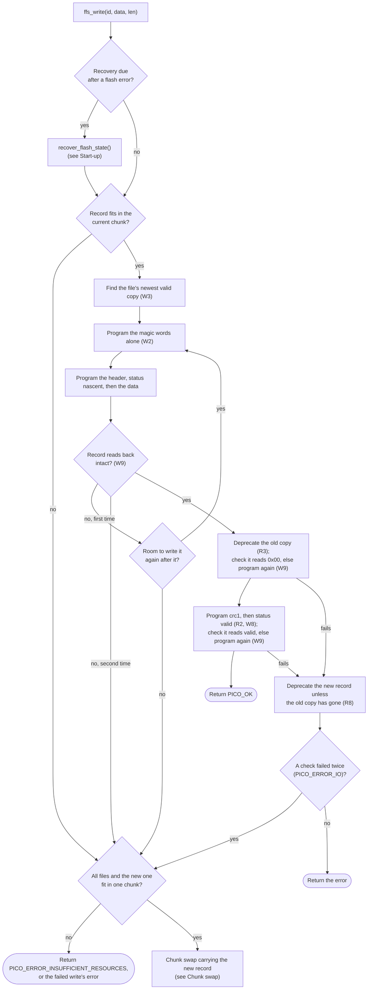
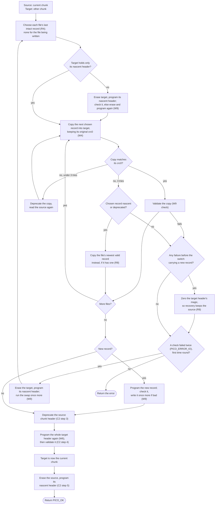
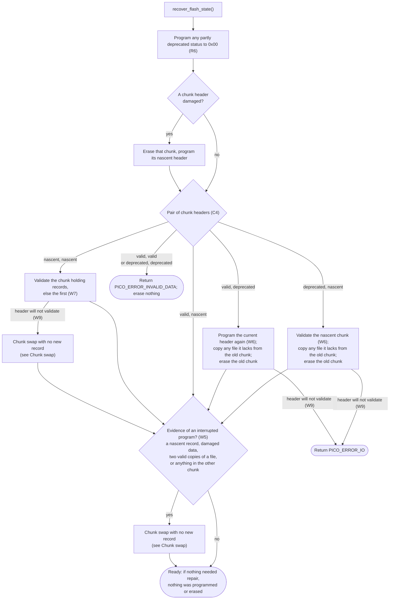

# "femto filing system" - A tiny footprint, lightweight flash filing system for RP2xx0
## Intended audience
It is recommended that the reader be at least somewhat familiar with the usage of the Raspberry Pi Pico SDK (henceforth the SDK) and operation of the RP2040 & RP2350 microcontroller devices.

## Introduction
This document describes the operation and intended applications of the "femto filing system", hereinafter referred to as **`ffs`** and styled in lower-case.

ffs is a tiny footprint, lightweight flash filing system which is recent addition to the SDK.  ffs is intended to hold configuration and other small data sets which require non-volatile storage; good examples are WiFi SSID and password settings, server and client details, user selected options, etc. etc.

Note: ffs does *not* in itself provide any security - data is stored in regular flash memory in clear text form.  But if needed, ffs can form part of a secure storage strategy if data stored in ffs is *first* encrypted from within the secure environment.  On retrieval, the data must be decrypted, again from within the secure environment of course.

The RP2350 has been designed for secure operation, please see the [RP2350 datasheet]( https://datasheets.raspberrypi.com/rp2350/rp2350-datasheet.pdf ) for further details.

Notably: ffs is designed to provide storage integrity in that if a file write operation is interrupted by power-off or other reset event, ffs:
- Will (on reboot) repair the filing system so as to put it again in a usable state.
- Will (by design) leave the file holding either its previous version or the new one, never a mixture or nothing (G2).

## ffs Design
Note: For a description of the API functions, please see the `ffs.h` header file - this information is not replicated here.

Note2: Although the Pico SDK flash API is actually provided by the device bootrom, it is still considered part of the "Pico SDK" and is referred to here as such.

### Flash offsets vs memory addresses
A perhaps non-obvious detail is that any code that uses the Pico SDK to:

- Erase and or write to flash memory.
- Read flash partition information (only RP2350+).

Must and will, use and retrieve, **flash offset** values to identify flash locations.  Legal flash offset values start at 0, for the first byte location in flash, and so range between `0` and `PICO_FLASH_SIZE_BYTES - 1`.

The ffs module largely makes use of offset values and most variables are named as such and use the `uint32_t` type.

But, directly reading from flash, by execution and/or de-referencing a pointer, requires a flash **memory address** (rather than an offset).  On RP2xxx the flash memory addresses start at `0x10000000` and the memory itself may "reflect" multiple times after this address depending on flash size, device and device set-up.

An additional complication is that on RP2350+, it is possible to *re*map a different area of flash memory to (appear) to start at `0x10000000`.  This is to be able execute separate, but identically built and located images, directly from flash.

To allow ffs to operate on RP2350+ within a flash remapped runtime environment, the source code makes use of the **un**remapped flash memory access provided by the device hardware and located at `0x14000000`.

The ffs source code defines the `FL_OFFSET_TO_READ_ADDR(_o)` macro which is used to generate memory pointer values from a flash offsets and obfuscate the above detail from (most) of the source.  The ffs design does not ever need to convert from a memory address to a flash offset.

### Organisation of ffs flash storage
For its operation, ffs requires a dedicated area of flash memory to be organised into **two** discrete "chunks".  At any point, *one* chunk will be used to store new records in flash, the other chunk is left pre-prepared but fallow.

ffs stores discrete data items in a *list* of "records" (aka files) the active chunk.  The design ensures that, as each new file is written, the virgin area of flash immediately after the last programmed file is used.   Each file record uses a "file header" (see below).  The file header structure contains a status field which is used by ffs to support its integrity protection mechanism - more on this below.

When, due to increasing flash storage use, new write data cannot be entirely written within the current chunk, ffs swaps chunks: it copies every current file, and the new write data, into the "other" chunk, then makes that chunk the current one, then erases the old chunk.  The copy is non-destructively interruptible, because the old chunk stays current until every copy is in place.  A special file at the start of each chunk is used as a marker to indicate the status of the chunk: active or fallow.  The chunk markers uses the record's status field and operates in a similar manner to a user accessible file.

This "two chunk" design results in a first-order limitation: All the stored valid files must fit into a *single* chunk.  This obviously holds true for both a single large file or a collection of mixed size files.

Because flash erasure is done on a per-sector basis, an ffs chunk **must** be an exact multiple of number of flash sectors in size *and* chunks must start on flash sector boundaries.

The total flash area used by ffs is therefore `2 * N * FLASH_SECTOR_SIZE` where `N` is the number of sectors allocated for a single chunk.  Please also see [Dimensions](#dimensions)

Note: The order files are stored in flash does not matter, because when a file is read, ffs scans for its newest valid record in the current chunk, or else in the other chunk (W3).  The flash scanning and file validating algorithm is quick to operate.

### File IDs, hierarchy etc.
There is no hierarchy of directories in ffs, it is a "flat" list of files, no file permission mechanism is provided.
ffs does not use human readable filenames to distinguish files but instead uses a "file identifier" or `file_id` which are stored in a single basic C data type.  File IDs should be defined on per-application basis using `#define` or an enumerated type.

If human readable filenames are required, the translation between file_id and ASCII text can be done by look-up, either by a hard coded table or possibly by storage within a file in ffs itself.

The length of the data is stored within the file header, which prefaces the data in the file record in flash memory.  Stored data is treated as raw or binary data, there are no reserved values within the data.  It is possible to store and retrieve *zero* data length files.

### File header structure
At the time of writing, the `ffs_file_hdr_t` file header structure is composed of:

- Two 32-bit words containing "magic values" to allow identification of this as a file header structure. Two words were chosen over one due to paranoia!
One magic word is ASCII readable, to aid debug using memory contents inspection, the other a random collection of bytes.
- A 16-bit data length - number of octets of file data starting immediately after the file header (can be 0).
- An 8-bit "file_id" - the unique reference used by the API to *select* a file for reading, writing or deletion.
- An 8-bit file "status" - used to indicate the provenance of the file record, see below.
- Two 32-bit CRC storage fields, `crc0` and `crc1`, see below.

### Design notes
In no particular order:

- ffs is *not* intended to provide for all possible applications, just to provide the smallest viable storage facility for a moderate number.
- One `file_id` value is reserved for ffs internal use and is used to signify a "chunk header".  A chunk header is a zero data length file which is only ever located at exactly at the start of a chunk.
- The ffs API will check that file IDs range between `0` and `FFS_MAX_VALID_FILE_ID` (inclusive) and will report `PICO_ERROR_INVALID_ARG` if FFS_MAX_VALID_FILE_ID is exceeded. With an 8-bit `file_id` FFS_MAX_VALID_FILE_ID is defined as 254 providing for 255 unique file IDs (with value 255 being used for the chunk header).
- If the size of the fields defined in `ffs_file_hdr_t` prove too restrictive for some specific applications, end users may of course modify the source code themselves. The API uses the SDK's *32-bit* `uint` type for the file ID and data length arguments so that application code will not need changing if the ffs source is modified to extend the range of allowable arguments over those described above.
- No version field is included because a "runtime updatable" file system is not envisaged or trivial!
- If ffs proves totally unsuitable for a given application, nothing in the Pico SDK precludes the user integrating an entirely different flash filing system.

### Storage integrity
As noted, ffs is designed to provide storage integrity; this is accomplished by using (a) a three-value "status" field and (b) the two CRC32 check values for each file (crc0 and crc1).

A new file is written in three discrete steps:

1. A file header structure is generated in memory with the status field set to all `1`s, this keeps the field in the flash "unprogrammed" and indicates a `nascent` file.  The header's first CRC value, crc0, is calculated from the header up to (not including) the status field, and the data to be programmed (if any).  The header's two magic words are programmed on their own first (W2), then the whole header immediately followed by the data.  At this point the header's crc1 field has also been left as all `1`s

2. Before programming, the file's newest valid record, i.e. the current copy, is found (W3).  Once the new record reads back intact (W9), *if* there is such a copy its status field is marked as `deprecated`, since there is now a stored nascent file which takes priority.  The deprecated status is written using all `0`s ensuring that file can't ever be returned to valid or nascent - that area of flash must be erased first.

3. The new file's status field is set to valid.  The valid state is encoded as a mixture of `1`s and `0`s meaning it is unequivocably neither nascent or deprecated and can never become nascent without erasure.  At this point the crc1 value is calculated, using crc0 and the newly set valid status field.  The crc1 field is programmed into flash *first* and then, in a separate programming operation, the status field, "validating" the file storage location.  crc1 is the commit mark (W8): once crc1 is good and any status bit has been cleared, the file is valid.  An interruption while programming crc1 leaves the status at `0xff`, so the file is still nascent; an interruption while programming the status cannot turn a valid file back into a nascent one.

Note: Steps (2) and (3) above make use of the "Write more zeros" flash programming methodology see [Flash write page cache](#flash-write-page-cache) for implementation.

This system design ensures there is only **one** identifiable copy of each unique file (based on file_id) in ffs flash at any one time.  If ffs initialisation finds a nascent file, or any other trace of an interrupted write, it moves every current file into the other, freshly erased, chunk (W5), keeping the newest record of each file as R4 describes. Deprecated files are ignored during file searches and are erased with their chunk.

If step (1) is interrupted, the partially written file fails its crc0 check and is ignored; it is erased with its chunk.  Note that a partially written file can contain erased (all `1`s) words, not least its unprogrammed crc1 field, so new files are only ever written where the *whole* remainder of the chunk is erased.

Power loss *during* a flash programming operation can leave a status byte only partly programmed, i.e. with only some of the bits that were being cleared actually cleared.  Because status bits are only ever cleared (nascent `0xff` -> valid `0x56` -> deprecated `0x00`), the interrupted transition can always be identified: a status with all of the valid bits still set is moving to valid, while a status with only valid bits set is moving to deprecated.  Partly programmed bits may read back unreliably, so initialisation completes any interrupted deprecation by programming the status byte fully.

Once a file header's crc0 check has passed, its status byte is interpreted as follows. crc1 is checked as if the status were `0x56`.

| Status byte | crc1 | Interpreted as | Notes |
|---|---|---|---|
| `0x56` | good | valid | |
| All of `0x56`'s bits set, plus others (an interrupted validation) | good | valid | crc1 was complete before the status program started (W8) |
| `0xff` | any | nascent | Validation not started, or crc1 interrupted |
| `0x56`, or all of `0x56`'s bits set plus others | bad | nascent | crc1 interrupted, or not programmed by older firmware (W8) |
| `0x00` | any | deprecated | |
| Only some of `0x56`'s bits set (an interrupted deprecation) | any | deprecated | Status programmed to `0x00` during initialisation |
| Anything else | any | unexpected data | Ignored; erased with its chunk |

For a chunk header, this means an interrupted swap is always recovered: it is never mistaken for a corrupt chunk, which would be erased.

A chunk swap is similarly interruptible: every current file is first copied into the other chunk, then the old chunk's header is marked deprecated, then the new chunk's header is marked valid, then the old chunk is erased.  If initialisation finds a deprecated chunk alongside a still nascent one, either the swap was interrupted between those two header steps, after every copy was made, or a swap carrying a new write failed after deprecating the old header and its new chunk was erased (R8). Either way the new chunk is validated, any file it lacks is copied from the old chunk, and the old chunk is erased.

### Weak cells after a power cut
A power cut part-way through a flash erase or program can leave a few cells *weak*: neither properly programmed nor properly erased. A weak cell may read correctly now and wrongly later, and may change from one read to the next. On Pico and Pico 2 boards, flash that a power cut left reading as erased, then programmed, gave wrong bits in some pages; with a steady supply, none did.

A weak cell can only come from the one flash operation that the power cut interrupted. ffs therefore aims to make every interrupted operation either leave visible evidence for initialisation to repair, or be harmless:

- **W1** Pages are programmed from a buffer filled with `0xff` apart from the bytes being written, never from a copy read back from flash. Programming a `1` leaves a cell as it is, so a weak bit elsewhere in the page that happens to read `0` is not programmed in for good.
- **W2** A new record's two magic words are programmed on their own, before the rest of its header. If a cut during that program leaves no visible trace, the next record is written at the same offset and programs the same bits, which makes any weak bit there solid. Any other interrupted program of a record leaves a visible record or damaged data.
- **W3** Reads, and R3, use the newest valid record of a file: the last one in the current chunk, otherwise the last one in the other chunk.
- **W4** A chunk swap copies every current file, and any new write, into the other chunk before it switches chunks (C2). Each copy keeps the original crc0 and is checked against it before it is validated, so a weak bit that read wrongly while copying is caught; the copy is then abandoned and made again. If a nascent record cannot be copied correctly in 3 tries, the file's newest valid record is copied instead, or none if it has none; if a valid record cannot, the swap fails with `PICO_ERROR_INVALID_DATA`.
- **W5** Initialisation moves every current file into the freshly erased other chunk (as W4) only if it finds evidence of an interrupted program: a nascent record, damaged data or an erased gap before the last programmed byte of the current chunk, two valid records of one file, or anything but a nascent header in the other chunk. With no such evidence, and nothing for R6 or C4 to repair, initialisation programs and erases nothing.
- **W6** Validating a chunk header programs the whole header again first, which makes solid any bit that an interrupted header program left weak.
- **W7** If both chunk headers are nascent, the second chunk is validated if only it holds records, otherwise the first, as when a weak status made the current chunk's header read nascent.
- **W8** crc1, checked as if the status were `0x56`, is the commit mark. A record with a good crc1 whose status has started to move to valid is valid, so a weak status bit cannot turn a valid record back into a nascent one.
- **W9** A program can also fail without reporting it: on a Pico 2, a program into a sector re-erased after an interrupted erase left a bit set. So every program ffs relies on is read back and checked: a new record must read back intact before its old copy is deprecated, a deprecated status must read `0x00`, and a committed record or chunk header must read as valid. A failed check is retried once: a new record is written again after the damaged one (or in a chunk swap if there is no room), a status or crc1 is programmed again, and a nascent chunk header is erased and programmed again. A bit that reads 0 where 1 is wanted cannot be fixed in place, only by an erase, so where a retry fails too:
  - `ffs_write()` writes the file in a chunk swap instead;
  - a chunk swap that fails before the switch erases the target and runs once more, as the source is unchanged (W4);
  - when start-up cannot validate a chunk header in the nascent & nascent case (W7), the chunk's records are moved to the other chunk by a chunk swap. In the other C4 cases, `ffs_initialise()` returns the error.

  If that fails too, the call returns `PICO_ERROR_IO`, and R8 decides which copy survives.

Interrupted erases need no extra rule: a chunk's nascent header is only programmed after its erase completes, so an erase interrupted after it has changed anything leaves a damaged header, and C4 erases the chunk again. One interrupted before that leaves the header as it was, which C4 or W5 handles.

ffs does not protect against a supply that sags without cutting out, which can leave weak cells while the flash reports success.

### Invariants
These are the rules the implementation must keep. Every change to ffs must be checked against them, and the power-fail test harness (`test/pico_ffs_powerfail_host`) tests them.

#### Guarantees to the caller
- **G1** After `ffs_initialise()` returns `PICO_OK`, each file holds the data from its last successful `ffs_write()`, or is absent if its last successful call was `ffs_delete()`.
- **G2** If an `ffs_write()` or `ffs_delete()` fails or is interrupted, then after the next `ffs_initialise()` the file holds either what it held before that call or what that call would have left. A later successful `ffs_write()` or `ffs_delete()` of the same file always takes priority.
- **G3** Every flash failure is reported. A call that hits one returns an error at that point and does nothing further that depends on it. `ffs_initialise()` either returns `PICO_OK` with every invariant below restored, or returns an error and leaves ffs uninitialised. The error identifies the kind of failure:
  - Flash contents that break these invariants and cannot be recovered, including a valid record that a chunk swap cannot read consistently (W4): `PICO_ERROR_INVALID_DATA`.
  - A failed flash erase or program: the error code returned by `flash_safe_execute()`, passed through unchanged, or `PICO_ERROR_IO` if there is none, or if a read-back check failed twice (W9).
  - An erase or program that would fall outside the ffs area (G4): `PICO_ERROR_INVALID_ADDRESS`, and nothing is erased or programmed.
  - Files that do not fit: `PICO_ERROR_INSUFFICIENT_RESOURCES`.
- **G4** ffs never erases or programs flash outside the ffs area.

#### Records
- **R1** Within a chunk, records are written in increasing order of offset, so a later record is always newer. Every record lies wholly within one chunk, and a header whose record would cross the end of its chunk is read as damaged data.
- **R2** A record's status only ever moves nascent → valid → deprecated. crc1 is programmed before the status is set to valid, and the status is set to valid only if crc1 was programmed successfully. A record is valid once crc1 is good and its status has started to move to valid (W8).
- **R3** Within a chunk, at most one record of a file is valid; during a chunk swap the copies in the new chunk and the originals in the old one are both valid until the old chunk is erased, and W3 decides. Before a record is made valid, the file's previous valid record is deprecated. If that deprecation fails, the new record is not made valid, and R8 applies. Should a weak bit ever leave two valid records of a file, the newest one is current (W3) and initialisation removes the older one (W5).
- **R4** The current version of a file is its newest valid record in the current chunk; a newer nascent record becomes current only when a chunk swap carries it. While a move-after chunk swap is incomplete (see C4), a file with no valid or nascent record in the current chunk is current in the old chunk, chosen there as below. When a chunk swap moves the files (C2, W4, W5), each file keeps its last intact record (valid, nascent or deprecated, but not damaged) if that record is valid or nascent; if it is deprecated, the file keeps its newest valid record (R8), or is absent if it has none. A last deprecated record counts, because it shows a later write or delete.
- **R5** `ffs_delete()` deprecates every valid *and* nascent record of the file, so a nascent record cannot bring a deleted file back.
- **R6** A partly programmed status is read as the state it was moving to (see the table above). During initialisation, any partly programmed deprecated status is programmed fully to `0x00`.
- **R7** A damaged record (bad crc0, or a status matching no state) is never read, moved or overwritten, except that a chunk-swap copy that fails its crc0 check has its status programmed to `0x00` (W4). New records are only written after the last programmed byte in the chunk, and damaged records are reclaimed when their chunk is erased. Damaged data in the current chunk is evidence of an interrupted program, so initialisation moves the files to the other chunk (W5).
- **R8** When `ffs_write()` fails, it deprecates its own new record if that record reads back as nascent and the file's previous valid record is still valid, or the file had none. The failed write then cannot appear after a reboot. If the previous record has already been deprecated, the new record is left nascent, so that initialisation validates it (R4) and the file is not lost. If this deprecation itself fails, the record stays nascent and G2 still holds. If a swap carrying a new write (C2) fails before it switches chunks, the new chunk's header is damaged, so that recovery erases that chunk and keeps the old one, whose records a swap never changes.

#### Chunks
- **C1** One chunk is current: the one whose header is valid. During a swap the old chunk stays current until C2 step 3 deprecates its header; between steps 3 and 4 no header is valid, and C4 makes the nascent one current.
- **C2** A swap runs in this order: (1) unless the new chunk holds only its nascent header, erase it and write that header; (2) copy each current file into it, and write the new record if there is one, validating each (W4); (3) deprecate the old chunk's header; (4) validate the new chunk's header (W6); (5) erase the old chunk and write its nascent header. Each step runs only if the steps before it succeeded.
- **C3** A chunk is erased only when it holds nothing current: its header is damaged, it is the other chunk at the start of a swap (or of its W9 retry) and holds more than its nascent header, or it is the deprecated chunk and every current file in it has been copied.
- **C4** During initialisation, each pair of chunk header states is handled as follows:

| One chunk | Other chunk | Meaning | Action |
|---|---|---|---|
| nascent | nascent | Empty ffs, or a weak current header (W7) | Validate the second chunk if only it holds records, otherwise the first; if that fails twice, move its records to the other chunk (W9) |
| valid | nascent | Normal | None |
| valid | deprecated | Swap interrupted after step 4 | Validate the current chunk's header again (W6), copy from the old chunk each file's surviving record (R4) that has no valid or nascent record in it, checked as W4, then complete step 5 |
| deprecated | nascent | Swap interrupted between steps 3 and 4, or a swap carrying a new write failed after step 3 and its new chunk was erased (R8) | Validate the nascent chunk, copy as above, then complete step 5 |
| damaged | any | Interrupted erase or header write | Erase it, write a nascent header, then handle the resulting pair |
| valid | valid | An invariant has been broken, for example by marginal flash bits | Fail with `PICO_ERROR_INVALID_DATA`; nothing is erased |
| deprecated | deprecated | An invariant has been broken | Fail with `PICO_ERROR_INVALID_DATA`; nothing is erased |

Neither chunk is erased in the last two cases because ffs cannot tell which one is newer, so the data stays in flash for recovery. ffs stays unusable until the ffs area is erased.

The copying in the valid & deprecated and deprecated & nascent cases only finds files when the swap was of the older, move-after kind, as written by earlier versions of ffs, or when a swap carrying a new write failed after step 3 (R8). It chooses each file's surviving record as a chunk swap does (R4), so a nascent record whose old copy was already deprecated is kept. After C4, initialisation applies W5.

### Flowcharts
These show the main paths through `ffs.c`. Any flash error not shown returns at once, after R8 for a write or the R8 header damage for a swap, and the next ffs call recovers first (G3).

#### Writing a file


#### Chunk swap
Used when a record does not fit (with a new record), and by start-up repairs (without one).


#### Start-up and recovery
`ffs_initialise()`, and the first call after a flash error, run `recover_flash_state()`.


### Atomicity
There is no concept of "opening a file" for subsequent read or write. Files in ffs are read, written, erased and listed in atomic and synchronous operations.
All data must be supplied to write a file, files can be read (direct from flash) using the supplied pointer up to the reported length of the file.  Due to the amount of context data held within the module, ffs is explicitly *not* threadsafe.

### Dimensions
The ffs code is designed around some basic assumptions controlled by:
- Flash programming *page* size.
- Flash *sector* size.

Common QSPI flash devices, including all those used on RPi Pico products, use a 256 byte programming page and 4096 byte sectors.

The ffs source code picks up these dimensions from the `FLASH_PAGE_SIZE` and `FLASH_SECTOR_SIZE` definitions which are defined on a per-board basis in the SDK environment.

A chunk can be at most 256 KB, because a chunk swap indexes the records within a chunk by 16-bit word index; `ffs_initialise()` returns `PICO_ERROR_INVALID_ARG` for a larger ffs area.

As noted, ffs is designed so that all data must fit in one flash chunk.  A design feature is that all file headers start on 32-bit word boundaries although the payload data can be any number of bytes (subject to the maximum length of `FFS_API_MAX_WRITE_LENGTH`).  By locating file headers on 32-bit boundaries the file search time is reduced compared to having to search on octet boundaries if "packed" file records were used.

At the time of writing, the file header structure is *five* 32-bit words in size. For the expected use cases, the header structure:
- Contains enough data for a sensible level of integrity checking.
- Is small enough in practice; it is not expected to need to store many dozens of different files.

### Flash write page cache
During operation, ffs makes use of the "Write more zeroes" approach which is applicable to flash memory which has an unprogrammed state of `1` and can program additional `0` bits in subsequent programming operations.  To permit the use of WMZ and indeed to provide a flexible/fast ffs internal flash programming API a "write page" cache is used.  All ffs writes to flash go through its write page caching mechanism.

To support the requirements of providing data integrity, the write page cache must be flushed into flash by programming before other fields in it are subsequently modified and the page programmed "again".
A "currently cached" page variable is maintained and is used to indicate when the cache is in use and must be flushed to finalise an operation and/or flushed because new data to be written is beyond the limits of the current page.

The cache is filled with `0xff` when a page is first cached, not read back from flash (W1). Programming `0xff` leaves flash as it is, so only the bytes ffs writes are changed.

### Dealing with virgin, used and corrupt flash
There is no need for any sort of explicit flash "formatting", ffs will work starting with totally unprogrammed flash.

Please note: Before commencing file operations, ffs *must* be initialised by calling `ffs_initialise()`.  This will check the flash state and automatically take steps to leave the ffs flash area ready for correct operation.  Note: This *may* include completing interrupted deprecations (R6), completing an interrupted chunk swap (C4), and moving every current file into the other chunk after a power cut that interrupted a write (W5). Damaged records are not voided; they are erased with their chunk (R7). If nothing needs repair, it programs and erases nothing.

If an `ffs_write()` or `ffs_delete()` call fails, other than for a bad argument or a file that cannot fit, the next ffs call first repeats this recovery from the flash contents before doing its own work. If the recovery fails, that call returns the error instead.

### `ffsgen` Generating a initial filing system
Many systems will require some "pre-programmed" configuration data to be present in flash when the system is first booted.  The `ffsgen` tool will construct and write a binary object file from a *list* of file IDs and their respective source files contained, in a config file.

For details of `ffsgen` build and operation, please see: [README_ffsgen.md](../../../tools/ffsgen/README_ffsgen.md)

### Flash area definition
At *run time*, ffs will calculate the number of flash sectors to used for each *chunk*.  The total flash available for ffs use is the `end offset - start offset`.
In builds for RP2350 (and later) devices, the ffs start and end offsets are *read* from the ffs partition entry size.  In builds for RP2040, the ffs start and end offsets must be *defined*.  This is done in `ffs.h` using overridable defaults per Pico-SDK style.

Below are two examples of minimum sized ffs flash regions

#### RP2350
For ffs usage, the flash memory RP2350 must be formatted into partitions using the `picotool` utility; ffs will *expect* to be able to locate partition dedicated for its usage – please see `FFS_DATA_PARTITION_ID` in `boot/bootrom_constants.h`.
A suitable entry in a partition table entry would be:
```
    {
      "name": "ffs storage area",
      "id": "0x746d656673665f6f",
      "size": "8K",
      "families": ["data"],
      "permissions": {
        "secure": "rw",
        "nonsecure": "rw",
        "bootloader": "rw"
      }
    }
```
Self evidently, the other partition(s) allocated for code and/or other data storage must be dimensioned to allow for (at least) size of the above partition to be added to the partition table to allow them all to fit in flash memory.

### RP2040

RP2040 Linker segment

Because there is no flash partitioning mechanism on RP2040, the location and size of the ffs area in flash must be known at build time (or link time, see below) - it can *not* be discovered at run time.

At the time of writing, `ffs.h` uses defaults, which can be overridden, to define the start and end of the ffs flash regions.  These defaults will put the ffs region at the very top of flash memory, specifically:
```
#define FFS_RP2040_FLASH_END_OFFSET    PICO_FLASH_SIZE_BYTES
#define FFS_RP2040_FLASH_START_OFFSET  (PICO_FLASH_SIZE_BYTES - (2 * FLASH_SECTOR_SIZE))
```

FIXME: A better approach, for which support may be added if time allows, would be the explicit definition on an ffs segment in the linker script.  This would provide "protection" of the desired ffs region in that the link step will fail if segments overlap or fail to fit in flash memory.  Some small modifications in ffs source would allow the the RP2040 build to pick-up the start offset and size of the ffs region at link time.
